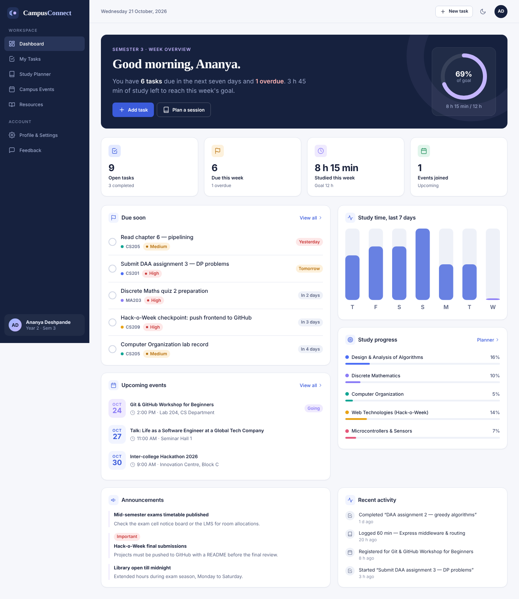

# CampusConnect — The Student Life & Productivity Hub

A full-stack web application built for the **Hack-o-Week (Semester III)** project. Students can manage tasks, plan study sessions, follow campus events, browse learning resources and send feedback — all from one responsive dashboard with light and dark themes.

| Layer | Technology |
| --- | --- |
| Frontend | React 18, React Router 6, Vite, CSS Modules, Fetch API |
| Backend | Node.js, Express 4 (CommonJS), JSON-file data store |
| Testing | Node's built-in test runner (`node --test`) for the API |



More screenshots: [dark mode](docs/screenshots/dashboard-dark.png) · [tasks](docs/screenshots/tasks.png) · [study planner](docs/screenshots/study-planner.png) · [events](docs/screenshots/events.png) · [mobile menu](docs/screenshots/mobile-menu.png)

---

## 1. Quick start

**Prerequisites:** [Node.js](https://nodejs.org/) 18 or newer (20 LTS recommended) and npm. Check with `node -v`.

```bash
# 1. Install dependencies for the root, server and client
npm run install:all

# 2. Start the API (port 5000) and the React app (port 5173) together
npm run dev
```

Open **http://localhost:5173**. The database is created automatically with sample data on first run.

### Other commands

| Command (run from the project root) | What it does |
| --- | --- |
| `npm run dev` | Runs the Express API and the Vite dev server together (hot reload) |
| `npm start` | Builds the React app and serves **everything from one port**: http://localhost:5000 |
| `npm test` | Runs 12 API integration tests against a temporary database |
| `npm run seed` | Resets `server/data/db.json` to fresh sample data (**stop the server first**, because the running server keeps its data in memory) |
| `npm run demo:http` | Starts the plain Node `http` module example on http://localhost:4000 |

Running the two halves separately also works:

```bash
cd server && npm run dev      # terminal 1 → http://localhost:5000/api/health
cd client && npm run dev      # terminal 2 → http://localhost:5173
```

**Troubleshooting**

- *"Cannot reach the CampusConnect server"* in the app → the API isn't running. Start it with `npm run dev`.
- *Port 5000 already in use* (common on macOS because of AirPlay) → run the API on another port, e.g. `PORT=5001 npm run dev --prefix server`, and change the proxy target in `client/vite.config.js` to match.
- Want a clean slate → stop the server, run `npm run seed`, start again.

---

## 2. Features

| Page | Route | What you can do |
| --- | --- | --- |
| Dashboard | `/` | Greeting, weekly study-goal ring, stat cards, tasks due soon (tick off with undo), 7-day study chart, subject progress, upcoming events, announcements, recent activity |
| My Tasks | `/tasks` | Create, edit, delete (with confirmation + undo), mark complete, search, filter by status/priority/subject, sort; filters remembered in the browser |
| Study Planner | `/study` | Subject cards with progress rings and exam countdowns, plan study sessions, mark them studied, academic deadlines |
| Subject detail | `/study/subjects/:subjectId` | Nested route: planned + completed sessions, linked tasks, edit/delete subject |
| Campus Events | `/events` | Search, category filters and "My registrations" (kept in the URL), capacity bars, register / unregister |
| Event detail | `/events/:eventId` | Full description, details, register/cancel, download an `.ics` calendar file |
| Resources | `/resources`, `/resources/:category` | Category navigation via route parameter, search, star resources to save them |
| Profile & Settings | `/settings/profile`, `/settings/preferences` | Edit profile (validated), theme (light/dark/system), compact mode, weekly goal, task preferences, start page, clear local data |
| Feedback | `/feedback` | Validated form (category cards, star rating, message), auto-saved draft, success state, history |
| 404 | any unknown URL | Friendly page with links back into the app |

Across the app: responsive sidebar → mobile drawer, skeleton loading states, empty states, error states with retry, toast notifications, offline banner, keyboard shortcut `/` to focus search, skip-to-content link, visible focus rings, and screen-reader labels.

---

## 3. Architecture

```
Browser ──► React app (Vite :5173)
              │  fetch('/api/...')   ← Vite proxies /api to :5000 in development
              ▼
           Express API (:5000)
              │  middleware: CORS → JSON parser → request logger → routes → 404 → error handler
              ▼
           store.js  ──►  server/data/db.json   (async fs, queued + atomic writes)
```

- **One source of truth on the server.** Tasks, subjects, sessions, events, profile and feedback live in the JSON store. The React app never treats `localStorage` as a database.
- **`localStorage` only for harmless per-browser conveniences:** theme, task filters, saved resources and an unsent feedback draft.
- **Shared state** (theme, profile, toasts) is provided with React Context. Page-local state stays in the page.
- **Production mode** (`npm start`) serves the built React files from Express, with a fallback to `index.html` so React Router handles deep links.

### Why a JSON file instead of SQLite?

SQLite drivers for Node need native compilation, which often fails on student laptops (especially Windows). A JSON file needs nothing extra, is easy to open and show during a demo, and is made safe for this single-user app by:

1. **Async I/O** with `fs/promises`.
2. **A write queue** — writes run one after another, so two requests can't corrupt the file.
3. **Atomic writes** — data goes to a temp file which is then renamed over `db.json`.
4. **Recovery** — an unreadable file is backed up and re-seeded instead of crashing the server.

It is not designed for many concurrent users; swapping `store.js` for a real database would not require changing any route.

### Authentication

The app is a single-student, locally-run project, so there is no login. That is a deliberate choice: no passwords are stored at all, rather than storing them insecurely. Adding auth later would mean hashed passwords (e.g. bcrypt) and HTTP-only session cookies.

---

## 4. Project structure

```
campusconnect/
├── package.json              # root scripts (install:all, dev, start, test, seed)
├── .gitignore
├── README.md
├── SYLLABUS_MAPPING.md       # syllabus topic → file mapping for evaluation
├── docs/screenshots/         # screenshots used in this README
├── server/                   # Node.js + Express (CommonJS)
│   ├── package.json
│   ├── .env.example
│   ├── examples/
│   │   └── basic-http-server.js   # plain `http` module server (separate from Express)
│   ├── scripts/
│   │   └── reset-db.js            # CLI: process.argv, fs, path
│   ├── tests/
│   │   └── api.test.js            # 12 integration tests (node --test)
│   ├── data/                      # db.json is created here at runtime (git-ignored)
│   └── src/
│       ├── server.js              # entry: init store, listen, graceful shutdown
│       ├── app.js                 # Express app, middleware order, routers, static files
│       ├── config.js              # process.env + path
│       ├── db/
│       │   ├── store.js           # async JSON store with write queue + atomic writes
│       │   └── seed.js            # realistic sample data (dates relative to today)
│       ├── middleware/
│       │   ├── asyncHandler.js    # forwards async errors to Express
│       │   ├── errorHandlers.js   # 404 + centralised error handler
│       │   ├── findById.js        # reusable "load record or 404"
│       │   ├── requestLogger.js   # method, URL, status, timing
│       │   └── validate.js        # schema-based body validation
│       ├── routes/                # dashboard, tasks, study, events, resources, feedback, profile
│       ├── services/              # activity log, study statistics
│       ├── utils/                 # env loader, HttpError, ids/dates
│       └── validators/
│           └── schemas.js         # validation rules for every resource
└── client/                   # React (Vite, ES modules)
    ├── package.json
    ├── vite.config.js        # dev proxy /api → :5000, CSS Modules config
    ├── index.html
    ├── public/favicon.svg
    └── src/
        ├── main.jsx          # providers + router
        ├── App.jsx           # route table (nested routes, params, lazy loading)
        ├── api/              # client.js (fetch wrapper, ApiError) + endpoints.js
        ├── context/          # ThemeContext, ProfileContext, ToastContext
        ├── hooks/            # useApi, useLocalStorage, useDebounce, useDomEvents
        ├── utils/            # format.js, validation.js, subjects.js
        ├── styles/global.css # design tokens (CSS custom properties), themes, reset
        ├── components/
        │   ├── layout/       # AppShell, Sidebar, Topbar, Logo, navItems
        │   └── ui/           # Button, Card, Badge, Modal, Form, Filters, Progress, States, Toaster, Icon…
        └── pages/            # Dashboard, Tasks, Study, Events, Resources, Settings, Feedback, NotFound
```

---

## 5. REST API

Base URL: `http://localhost:5000/api`. All responses are JSON. Successful responses look like `{ "data": ... }`; errors look like:

```json
{ "error": { "status": 400, "message": "Validation failed.", "details": { "title": "Title is required." } } }
```

| Method | Endpoint | Description | Success |
| --- | --- | --- | --- |
| GET | `/health` | Server status, uptime, Node version | 200 |
| GET | `/dashboard` | Aggregated dashboard data | 200 |
| GET | `/tasks?status=&priority=&subjectId=&q=&sort=` | List / filter / search tasks | 200 |
| GET | `/tasks/:id` | One task | 200 / 404 |
| POST | `/tasks` | Create a task | 201 |
| PUT | `/tasks/:id` | Replace a task's editable fields | 200 |
| PATCH | `/tasks/:id` | Partial update (e.g. `{ "status": "done" }`) | 200 |
| DELETE | `/tasks/:id` | Delete a task | 204 |
| GET | `/study/subjects` | Subjects with computed progress | 200 |
| GET | `/study/subjects/:id` | Subject + sessions + linked tasks | 200 / 404 |
| POST | `/study/subjects` | Create a subject (duplicate names → 409) | 201 |
| PUT | `/study/subjects/:id` | Update a subject | 200 |
| DELETE | `/study/subjects/:id` | Delete subject and its sessions, unlink tasks | 204 |
| GET | `/study/sessions?subjectId=&from=&to=` | List study sessions | 200 |
| GET | `/study/stats` | Last-7-days minutes and totals | 200 |
| POST | `/study/sessions` | Plan a session | 201 |
| PATCH | `/study/sessions/:id` | Update a session (e.g. mark completed) | 200 |
| DELETE | `/study/sessions/:id` | Delete a session | 204 |
| GET | `/events?category=&q=&registered=true` | List / filter events | 200 |
| GET | `/events/categories` | Distinct categories | 200 |
| GET | `/events/:id` | One event | 200 / 404 |
| POST | `/events/:id/register` | Register (already registered or full → 409) | 201 |
| DELETE | `/events/:id/register` | Cancel registration | 200 |
| GET | `/resources?category=&q=` | List resources | 200 |
| GET | `/resources/categories` | Categories with counts | 200 |
| GET | `/feedback` | Submitted feedback | 200 |
| POST | `/feedback` | Submit feedback (validated) | 201 |
| GET | `/profile` | Student profile and preferences | 200 |
| PUT | `/profile` | Update profile details | 200 |
| PATCH | `/profile/preferences` | Update one or more preferences | 200 |

Try it from a terminal while the server runs:

```bash
curl http://localhost:5000/api/tasks?priority=high
curl -X POST http://localhost:5000/api/tasks -H "Content-Type: application/json" \
     -d '{"title":"Revise sorting algorithms","dueDate":"2026-11-05","priority":"medium"}'
```

---

## 6. Testing

- **API:** `npm test` runs 12 integration tests (CRUD, validation, malformed JSON, conflicts, cascade delete, persistence, 404s) against a throwaway database file.
- **Browser workflows** were checked end-to-end in Chromium at desktop (1440 px) and mobile (390 px) sizes: dashboard load, full task lifecycle, study session → progress update, event filters and registration, resource bookmarks, feedback validation and submission, profile save, dark mode, 404 navigation, keyboard shortcut, and no horizontal scrolling on mobile.

---

## 7. Git & GitHub workflow

### First upload

```bash
cd campusconnect
git init
git add .
git commit -m "Initial commit: CampusConnect full-stack app"
git branch -M main
# Create an EMPTY repository on github.com first (no README), then:
git remote add origin https://github.com/<your-username>/campusconnect.git
git push -u origin main
```

`node_modules/`, `client/dist/` and `server/data/db.json` are excluded by `.gitignore`; anyone who clones the repo runs `npm run install:all` and the database is re-created from seed data.

### Feature branch → pull request → merge

```bash
git checkout -b feature/pomodoro-timer     # 1. create a branch
# ...edit files...
git status                                 # 2. see what changed
git add client/src/pages/Study
git commit -m "Add pomodoro timer to study planner"
git push -u origin feature/pomodoro-timer  # 3. publish the branch
```

4. On GitHub, click **Compare & pull request**, describe the change, and request a review from a teammate.
5. After approval, click **Merge pull request**, then update your local copy:

```bash
git checkout main
git pull origin main
git branch -d feature/pomodoro-timer
```

### Merging locally and resolving conflicts

```bash
git checkout main
git merge feature/pomodoro-timer
# If Git reports a conflict: open the file, keep the right lines,
# remove the <<<<<<< ======= >>>>>>> markers, then:
git add <file>
git commit
```

Useful commands: `git log --oneline --graph`, `git diff`, `git branch -a`, `git stash`.

---

## 8. Demo script for faculty (about 5 minutes)

1. **Dashboard** — "Everything here comes from my Express API in one request (`GET /api/dashboard`). The ring shows weekly study progress against the goal set in Settings." Tick off a due task and show the **Undo** toast.
2. **My Tasks** — add a task with an empty title to show client-side validation, then a valid one. Search with `/`, filter by priority, mark complete, edit, delete with confirmation. Refresh the page to prove the data persisted on the server.
3. **Study Planner** — plan a session, open a subject (nested route `/study/subjects/:subjectId`), mark the session studied and watch the progress ring update.
4. **Events** — filter by *Workshop* (note the URL changes), register for an event, open its detail page, download the calendar file. Show that a full event can't be joined (the server returns 409).
5. **Settings** — switch to dark mode (CSS custom properties + Context + localStorage), change the weekly goal, then return to the dashboard.
6. **Code tour** — `server/src/app.js` (middleware order), `middleware/validate.js`, `db/store.js` (async fs + atomic writes), `client/src/hooks/useApi.js` (custom Hook), `pages/Tasks/TaskList.jsx` (prop drilling vs Context), and `server/examples/basic-http-server.js` (Express vs plain `http`).
7. Run `npm test` to show 12 passing API tests.

See **SYLLABUS_MAPPING.md** for where each syllabus topic is implemented.
